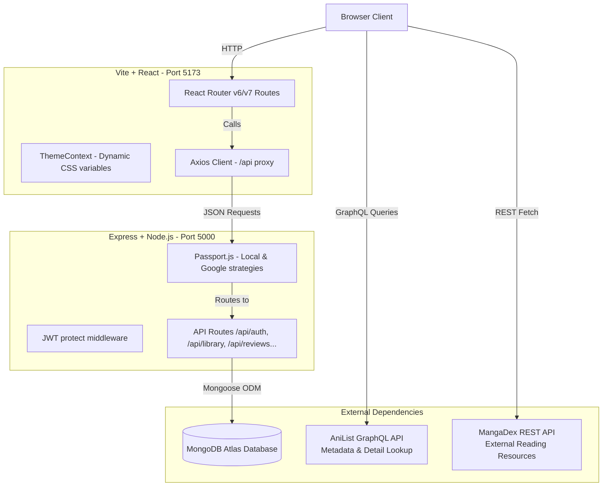
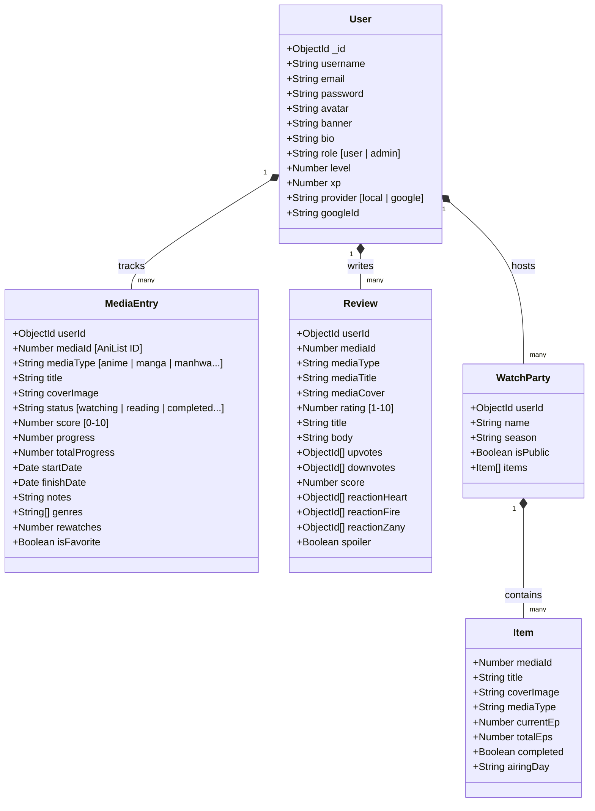

# Kiroku: Full-Stack Architecture Reference Manual

This guide describes the architectural design, database layouts, third-party integrations, authentication mechanisms, and reactive systems of the **Kiroku** anime and manga tracking application.

---

## 1. System Topology Overview

Kiroku is structured as a **decoupled MERN/MEAN-style web application** split into a dedicated frontend client and a stateless backend REST API.



---

## 2. Directory Layout & Key Modules

The project is structured under the `kiroku` parent directory:

*   **`client/`**: React 18 frontend environment.
    *   `vite.config.ts`: Configuration file defining proxy overrides for `/api` and `/uploads` to port `5000`, as well as build limits.
    *   `src/App.tsx`: Central router layout. Defines public routes (`/login`, `/register`), standard layouts, and auth protection guards (`Protected`, `AdminRoute`).
    *   `src/context/ThemeContext.tsx`: Theming context. Bypasses standard React state delays by dynamically writing CSS custom properties to the document element (supporting *Midnight*, *Sakura*, *Shrine*, and *Archive* presets).
    *   `src/constants/colors.ts`: Custom Proxy system intercepting style lookups to read dynamic CSS theme variables reactively.
    *   `src/pages/Stats.tsx`: Recharts-based telemetry reporting page (score distribution, watch status, genre radar).
*   **`server/`**: Express server environment running TypeScript.
    *   `src/index.ts`: Application entry point initializing security headers (helmet), CORS credentials, session stores, passport routes, and port mapping.
    *   `src/config/db.ts`: Connection handler linking Mongoose ODM to MongoDB Atlas.
    *   `src/config/passport.ts`: Configures Local Strategy (email/password) and Google Strategy (OAuth 2.0 mapping and profile synchronization).
    *   `src/middleware/auth.ts`: Authentication interceptor verifying incoming JWTs inside request headers or cookies.
    *   `src/models/`: MongoDB schema declarations.

---

## 3. Database Schema Models (Mongoose)

Kiroku stores application states inside four collections:



---

## 4. Key Architectural Mechanisms

### A. Dual JWT & Google OAuth Flow
Authentication handles both local passwords and third-party credentials seamlessly:

1.  **Local registration/login**: Express hashes passwords via `bcryptjs` and signs a JWT containing the user ID.
2.  **Google OAuth**: Passport coordinates the OAuth redirect callback. If a profile matches an existing email, it attaches the `googleId` to link accounts. On success, it redirects to the client callback `/oauth/callback?token=...`.
3.  **Transmission**: Token issuance sets an HTTP-only cookie `token` AND returns the token in the response payload to allow client-side header inclusion.

### B. Proxy-Driven React Custom Theming
To support instant theme swapping without DOM re-renders or theme-related component re-paint bottlenecks, Kiroku uses custom CSS proxy mappings:

1.  **Definition**: Theme definitions are held inside [ThemeContext.tsx](file:///c:/padhai/projects/kiroku/client/src/context/ThemeContext.tsx).
2.  **Application**: On mount or select, the context script loops through the palette keys and calls:
    ```javascript
    document.documentElement.style.setProperty(`--ov-${key}`, value);
    ```
3.  **Reactive Reading**: Components resolve their inline styling by referencing `C.colorKey`. The proxy interceptor inside `colors.ts` automatically executes a DOM query to return the current CSS variable value.

### C. Live Analytics Reporting
The analytics module in `client/src/pages/Stats.tsx` maps user logs to visual telemetry:
*   **Genre distribution**: Visualized as a custom Radar Chart displaying top tracked media categories.
*   **Progress stats**: Visualized as horizontal bars and custom segmented Pie Charts utilizing theme-reactive colors.
*   **Score distribution**: Standard vertical bar chart displaying user rating behavior (1-10 scale).
