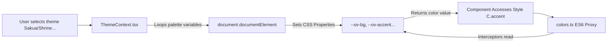
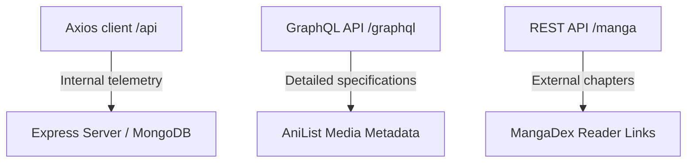

# Kiroku: Frontend Architecture & Feature Explanation Guide

This guide details the core technologies, design decisions, custom styling patterns, API integrations, and animation details implemented in the **Kiroku Frontend**. Use this reference to explain your implementation choices, engineering patterns, and design achievements to your evaluator or supervisor ("sir").

---

## 1. High-Level Technology Choices

*   **Vite + React 18 + TypeScript**:
    *   **Vite**: Chosen over Create React App (CRA) due to its lightning-fast **Hot Module Replacement (HMR)** (which uses native ES modules to update only changed components in milliseconds) and its highly optimized rollup production builds.
    *   **TypeScript**: Imposes strict contract checks on backend data (e.g. strict interfaces for `User`, `MediaEntry`, `Review`, and `WatchParty`), preventing runtime null reference crashes.
*   **React Router (v6/v7 compatible)**:
    *   Implements declarative client-side SPA routing inside [App.tsx](file:///c:/padhai/projects/kiroku/client/src/App.tsx).
    *   Features a persistent sidebar framework (`Layout.tsx`), session protection blocks (`Protected`), and role authorization guards (`AdminRoute`) that secure endpoints like the administration panel.

---

## 2. Dynamic, Proxy-Based Theme Orchestration (Zero-Delay Styling)

Instead of relying on heavy CSS frameworks or standard React state re-renders (which cause lag and layout shifts during page transitions), Kiroku leverages a **reactive CSS custom properties pipeline**:



### Technical Highlights to Explain:
1.  **State Isolation**: Theme assets are defined as flat hex key-value structures inside [ThemeContext.tsx](file:///c:/padhai/projects/kiroku/client/src/context/ThemeContext.tsx). Changing themes triggers a single DOM-level write:
    `document.documentElement.style.setProperty('--ov-accent', '#f472b6')`.
2.  **The ES6 Proxy Guard**: [colors.ts](file:///c:/padhai/projects/kiroku/client/src/constants/colors.ts) creates a JavaScript `Proxy` over fallback palette objects:
    ```typescript
    export const C = new Proxy({} as Colors, {
      get(_target, prop) { return readCSSVar(prop); }
    });
    ```
    Every time a component evaluates style attributes (`color: C.accent`), the Proxy intercepts the call, reads the latest value of the CSS custom variable directly from the DOM, and applies it immediately without waiting for state synchronization.

---

## 3. Client-Side API Architecture & Integrations

The client manages data from three separate endpoints to deliver seamless user tracking:



### Integration Details:
*   **GraphQL Query Executor (AniList)**: Rather than querying a bulky intermediary server, the frontend constructs and transmits localized GraphQL queries directly via HTTP `POST` requests to `https://graphql.anilist.co`. This allows the client to fetch exactly the details it requires (studios, characters, trailer details) in a single request.
*   **MangaDex Sync**: Feeds query parameters directly to `https://api.mangadex.org` to fetch real-time lists of translated manga chapters, cover art, and external reading links.
*   **Axios Interceptor**: Automatically attaches the JWT bearer authorization headers from `localStorage` (`ov_token`) to every request targeting the `/api` Express backend routes.

---

## 4. Complex Front-End Features

### A. Coordinate-Based Floating Emoji Reaction System
Review cards feature interactive animated emojis (`heart`, `fire`, `zany`). Triggering a reaction spawns coordinate-based floating emoji animations:

1.  **Coordinate Capture**: On click, `spawnEmoji()` extracts the exact click event coordinate bounding box relative to the target button element:
    ```typescript
    const rect = e.currentTarget.getBoundingClientRect();
    const x = e.clientX - rect.left;
    const y = e.clientY - rect.top;
    ```
2.  **Render Lifecycle**: A temporary React state object is generated: `{ id: Date.now(), char: '🔥', x, y, reviewId }`.
3.  **CSS Animation**: The element is rendered at `absolute` coordinates with a CSS `@keyframes floatUp` rule:
    ```css
    @keyframes floatUp {
      0% { transform: translate(-50%, -50%) scale(1); opacity: 1; }
      100% { transform: translate(-50%, -80px) scale(1.5); opacity: 0; }
    }
    ```
4.  **Garbage Collection**: A `setTimeout` removes the node from the coordinate array after 800ms to free up browser memory.

### B. Analytics & Interactive Visual Charts (Recharts)
The user stats page ([Stats.tsx](file:///c:/padhai/projects/kiroku/client/src/pages/Stats.tsx)) processes libraries into real-time metrics:
*   **Bar Chart**: Displays score frequency distributions (1 to 10 scale).
*   **Pie Chart**: Visualizes status breakdowns (e.g. Watching, Completed).
*   **Radar Chart**: Maps user genre profiles.
*   **Aesthetics**: Segment chart color parameters are dynamically mapped to active theme colors (`STATUS_COLORS`) to maintain visual harmony.

### C. UX & Viewport Optimizations
*   **iOS Zoom Override**: Set input and text area sizes to a minimum of `16px` to bypass iOS Safari's default input zoom-on-focus.
*   **Kanban Tracker Board**: Statuses are organized as Kanban columns mapping active anime/manga lists with dot markers.
*   **Reddit-Style Voting**: Upvote and downvote toggles featuring horizontal capsules with orange (upvote) and blue (downvote) active selection states.
